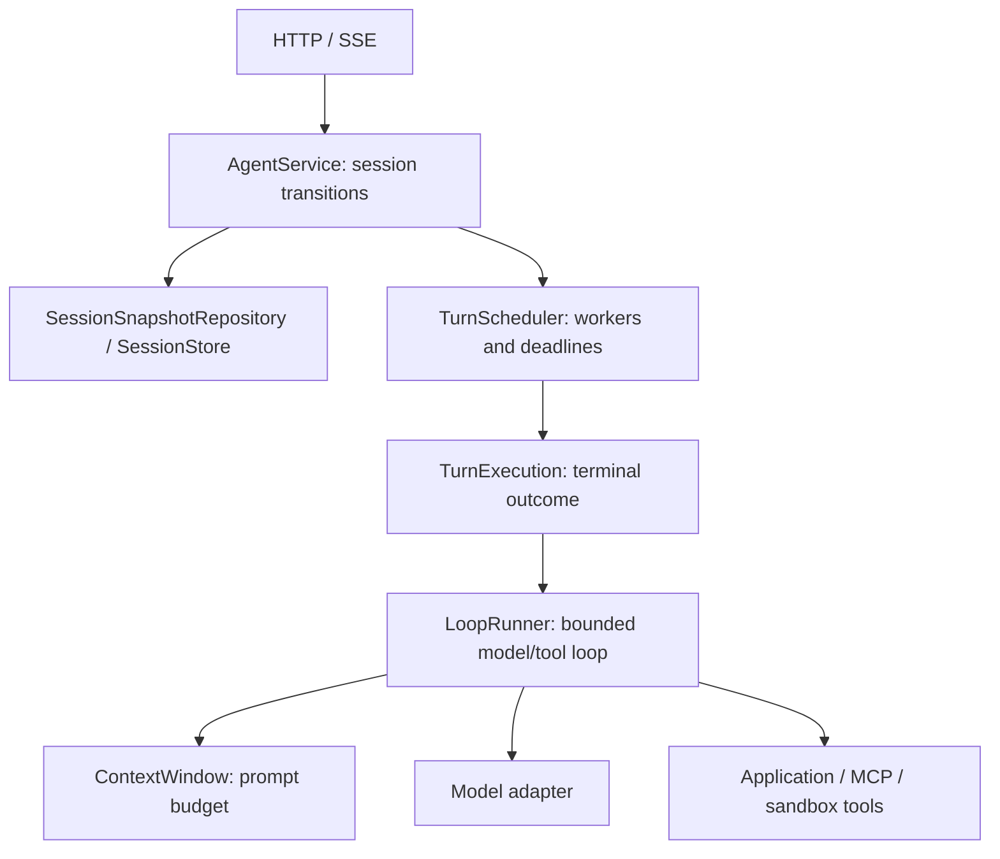

# Architecture and execution contract

TurnForge separates transport, session ownership, scheduling, harness execution and provider adapters. `core` has no Spring dependency. `config` is the composition root; `web` translates HTTP into core operations. Existing Java package names and `redy.*` properties remain compatible.

| Boundary | Owner | Contract |
| --- | --- | --- |
| HTTP validation and event transport | `web` | Strict JSON requests, stable error envelope, replay cursors, bounded SSE buffer |
| Session transactions | `AgentService` | One active turn per session; items, state and events persist together before acknowledgment |
| Worker resources | `TurnScheduler`, `RuntimeLimits` | Bounded concurrency/queue; cooperative execution deadline; deterministic shutdown |
| Terminal outcomes | `TurnExecution` | Completed, cancelled or failed; timeout is failed, user cancellation is cancelled |
| Agent harness | `LoopRunner`, `ResumableRunner` | Step budget, model decisions, tool validation, retry/dedup, context and external handoff checkpoints |
| Model context | `ContextWindow` | Reserve instructions, tool schemas and output budget; preserve tool exchanges; compact older groups |
| Storage | `SessionSnapshotRepository`, `FileSessionStore` | Session snapshot encoding; temporary write, file fsync, atomic replacement |
| Integrations | `OpenAiCompatibleModel`, `mcp`, `cube` | Provider details stay outside HTTP/session logic |

## State ownership

A session is `idle`, `in_progress`, or `requires_action`. A turn is `in_progress`, `waiting`, `cancelling`, or terminal (`completed`, `failed`, `cancelled`). Queued work currently uses `in_progress` at the API layer until a worker enters the harness. A terminal turn moves the session to idle; idle does not imply success.

`AgentService` holds a process lock while updating in-memory state and committing its snapshot. It rolls back the affected state if persistence fails. Model calls, tool execution and sandbox lifecycle network calls happen outside that lock. Event consumers only see committed events; delivery callbacks run outside the lock. A complete snapshot includes session/turn state, conversation context, execution items, event history, external results, steering claims and checkpoints.

`TurnScheduler` bounds workers and queued tasks. Overload records a failed turn and returns `503`; rejected work never calls a model or tool. Each execution segment starts a deadline when its worker begins and cancels its timer on exit. External waiting releases the worker. Resuming has a fresh time allowance and the persisted total step count. Timeouts and cancellation interrupt cooperatively. A noncooperative adapter can keep its worker occupied; terminal status must not imply a remote side effect was rolled back.

## Tool protocol

1. Fit instructions, messages and tool metadata into the prompt budget; claim steering at the next model boundary.
2. Record `model.call.started` and outcome with step, model and elapsed time. These events expose timing, not provider reasoning or exact token accounting.
3. Validate the selected tool and its arguments. Persist a function-call item before invoking a local/MCP/sandbox side effect.
4. Execute through `ToolExecutionContext` (session and call ID), validate the result and save its paired output. Cancellation/failure pairs unanswered calls with failure outputs so subsequent model requests remain well formed.
5. A repeated call ID with identical signature reuses its cached result within the checkpoint; a changed signature fails. A failed signature gets at most one model-requested retry when the tool is idempotent and the failure is retryable. The runtime never automatically retries arbitrary side effects.
6. An `ExternalFunctionTool` saves a waiting checkpoint and `required_actions`. `/events` validates the turn/call identity, stores its result and resumes. Duplicate identical results are accepted; conflicting duplicates are rejected.

Tool schemas describe inputs to the model. Tools must implement semantic validation themselves. Unknown tools and malformed provider decisions fail the turn. Model responses with multiple parallel tool calls fail explicitly. Cancellation of an MCP request ends the local wait; the server may continue executing.

## Context and steering

The default token estimator conservatively counts UTF-8 bytes plus message overhead. Tools, instructions and retained provider reasoning state all consume prompt space. Older groups can be replaced with an extractive summary, and current tool output can be truncated while preserving metadata. User text is not silently shortened. Steering inserted between a tool call and result cannot form a compaction boundary; historical exchanges are also kept or omitted together. An oversized protected turn fails before calling the provider. Original items remain available even when the model-context view is compacted.

Replace the estimator/compressor by constructing a `ContextWindow` and supplying it to `LoopRunner`. A production semantic summarizer must manage its own latency, cancellation and cost. The fallback does not claim semantic memory quality.

## Recovery decisions

| Durable checkpoint at restart | Recovery |
| --- | --- |
| Completed/failed/cancelled turn | History and event identities remain stable |
| Waiting external function | Preserve `requires_action` and the original call ID; await its result |
| Safe checkpoint before model/tool dispatch | Resume from that checkpoint |
| Interrupted in-flight execution | Fail with a reconciliation message; do not replay uncertain effects |
| Cancelling turn | Complete cancellation and pair unanswered calls |
| Sandbox pausing/resuming/killing | Keep the transition; retry the same lifecycle endpoint to reconcile |

A checkpoint is marked unsafe before entering execution. Side effects and local snapshots are not one distributed transaction. Applications must supply their own idempotency or reconciliation keyed by session/turn/call. Creating a Cube sandbox and saving its session are also separate; a process crash between them can orphan a sandbox.

## Composition and extension

The default composition merges Spring `Tool` beans, optional Cube tools and discovered MCP tools, rejecting name collisions. `Model`, `Runner`, `SessionStore` and `SandboxProvisioner` are replaceable beans. A supplied runner controls its own tools/context; a supplied store controls durability. MCP discovery completes before readiness and failures close initialized clients and abort startup. An `example-tools` profile adds an external approval tool without changing defaults.

The bundled model adapter speaks nonstreaming OpenAI-compatible Chat Completions. It preserves supported reasoning fields with retained messages, bounds response size and uses per-request timeouts. Provider examples and MCP/Cube trust boundaries are in [providers.md](providers.md).

## Current scaling boundary

Snapshots are whole-session files and the service lock serializes commits across sessions. Event/item history and session count grow until the operator archives the data. One data directory belongs to one service process; no distributed job ownership or cross-process file locking is provided. A per-session lock plus append-only event log, retention/pagination and distributed leases would require storage/concurrency changes and are outside this release. Each SSE subscriber uses a dispatcher and writer thread, bounded by the subscriber limit; slow clients are disconnected and can reconnect using their last committed event ID.
